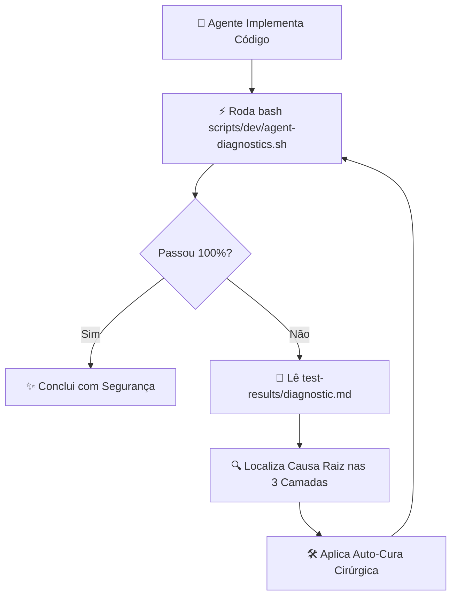

# 🔄 Skill: self-healing (RestauraFoto)

Esta skill capacita o agente de IA a operar em **malha fechada e auto-cura contínua (TACL Triplo)** na arquitetura híbrida do RestauraFoto (Tauri v2 + Rust + PyO3 + Python/OpenCV + TypeScript), reduzindo o tempo de depuração, eliminando regressões e garantindo harmonia entre as três camadas do ADR 0001.

---

## ⚡ 1. O Princípio da Malha Fechada (Closed-Loop)

Em vez de presumir que o código compilou ou pedir para o desenvolvedor testar manualmente, o agente assume a responsabilidade total pelo ciclo:

---

## 🛠️ 2. Comandos Operacionais Essenciais

| Objetivo | Comando | Tempo Típico |
| :--- | :--- | :--- |
| **Diagnóstico Completo Unificado (MD)** | `bash scripts/dev/agent-diagnostics.sh` | ~4 a 5 segundos |
| **Apenas Casca Rust (Tauri / PyO3)** | `cargo check --manifest-path src-tauri/Cargo.toml` | ~3 segundos |
| **Apenas Motor Python (OpenCV/NumPy)** | `.venv/bin/python -m unittest discover -s tests -p "test_*.py"` | ~0.2 segundos |
| **Apenas Tipagem Frontend (TypeScript)** | `npx tsc --noEmit` | ~0.9 segundos |
| **Formatação Rust** | `cargo fmt --manifest-path src-tauri/Cargo.toml` | Instantâneo |

---

## 📋 3. Protocolo de Diagnóstico & Auto-Cura

Quando qualquer camada acusar falha:

1. **Inspecione o Relatório Estruturado:**
   * Leia o arquivo gerado em [`test-results/diagnostic.md`](/test-results/diagnostic.md).
   * Ele aponta a camada afetada (Rust, Python ou TypeScript), o arquivo, linha, código do erro e a sugestão do compilador ou traceback de teste.
2. **Prioridade de Resolução:**
   - **Camada Rust / PyO3:** Se quebrar a ponte FFI ou tipagem do Tauri, resolva primeiro.
   - **Camada Python:** Se um filtro OpenCV retornar `None`, estourar canal ou falhar no inpainting, ajuste a função em `src-tauri/restaurar.py`.
   - **Camada TypeScript:** Se os eventos ou DTOs trocados via `invoke` mudarem, ajuste as interfaces no `src/main.ts`.
3. **Portão Final de Qualidade:**
   * Antes de reportar qualquer entrega concluída ao usuário, certifique-se de que `bash scripts/dev/agent-diagnostics.sh` retornou `🟢 SAUDÁVEL / APROVADO`.
